# Danish power market analysis, 2025

How Denmark's electricity was supplied and priced in 2025, and how well the
baseline model (one node, net imports fixed) reproduces it.

Regenerate everything with:

```bash
python main.py
```

```bash
python data_analysis/analysis.py
```

Figures are in [`figures/baseline/`](figures/baseline/). Key numbers are in
[`figures/baseline/key_figures.csv`](figures/baseline/key_figures.csv).

## 2025 at a glance (actual data)

| | 2025 |
|---|---|
| Electricity consumption | 40.5 TWh |
| Wind | 47% of consumption |
| Solar | 11% |
| Danish thermal plants | 23% |
| Net imports | 18% |
| Hours where wind + solar exceeded consumption | 871 |
| Hours Denmark was a net exporter | 2,307 |
| Average day-ahead price | 81.6 €/MWh |
| Price range | −30.6 to 583.4 €/MWh |
| Hours with negative prices | 341 |
| Wind capture price (what wind earned per MWh) | 69.0 €/MWh, 85% of average |
| Solar capture price | 51.0 €/MWh, 62% of average |

## 1. Dispatch

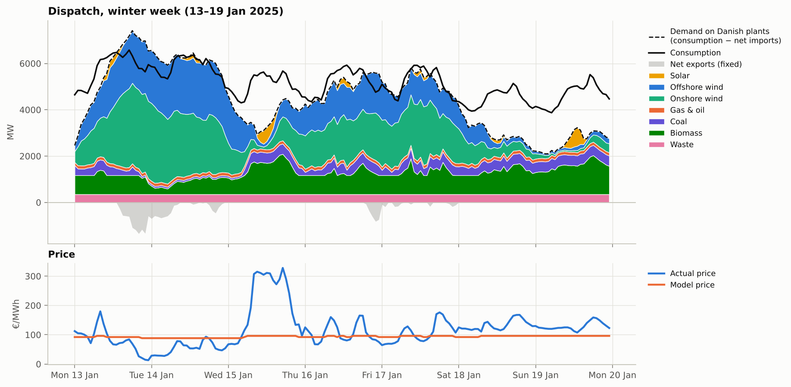

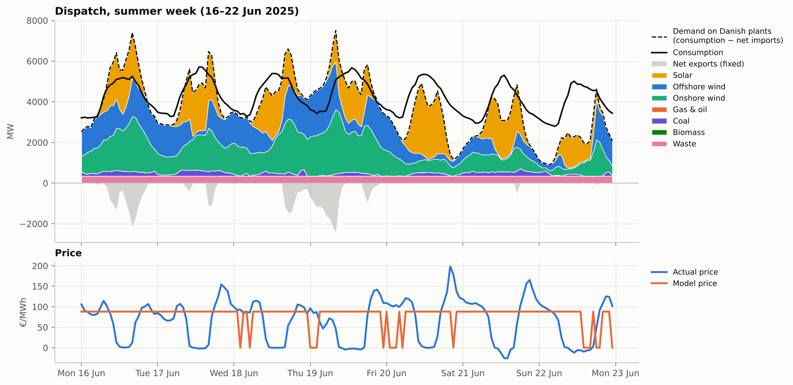

- **Wind sets the rhythm.** In the winter week, wind covers almost all demand
  on the 13th and 14th. Denmark exports the surplus (grey area below zero),
  and the actual price falls to about 15 €/MWh.
- **When wind drops, imports and thermal plants fill the gap.** On 15 January
  wind fell sharply and the actual price spiked above 300 €/MWh. The model
  stays at about 95 €/MWh, because its imports are fixed at what actually
  happened, so it never sees the scarcity that drove the real price.
- **Waste and biomass CHP plants run all the time** (must-run), even in summer.

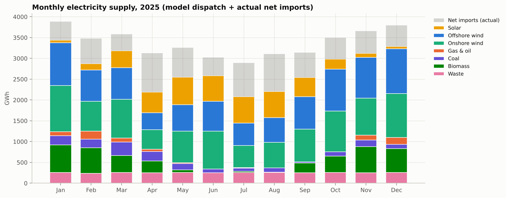

- Thermal output is concentrated in winter (heat demand). From May to August
  it is almost only waste plants plus a little coal and biomass.
- Solar is a summer resource (April–September). Wind is strongest from
  October to March.
- Denmark is a net importer in every month. Imports are largest in April, July
  and August, when wind is weaker and thermal plants are mostly off.

## 2. Prices

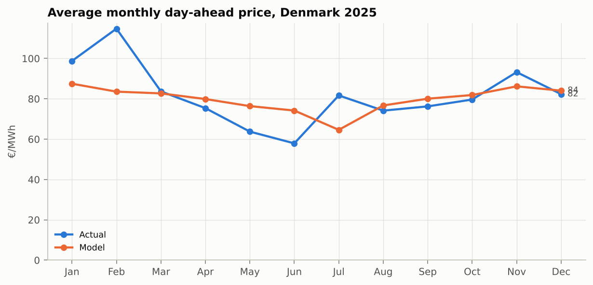

- The model matches the yearly average well (79.8 against 81.6 €/MWh) and
  follows the seasonal pattern: higher in winter, lower in late spring.
- It misses the extremes. It underestimates January and February (cold spells,
  high gas prices abroad) and overestimates May and June (cheap solar and
  Nordic hydro imports).

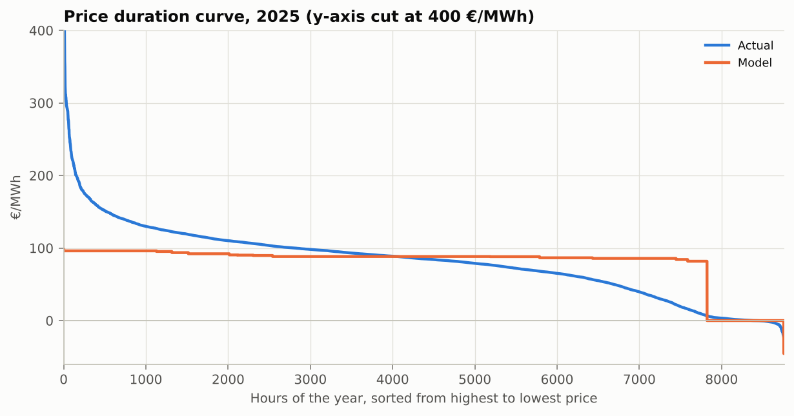

- The real price is spread out: 151 hours above 200 €/MWh and a long
  tail towards zero.
- The model price is almost flat at 85–96 €/MWh, then drops straight to zero
  for about 930 hours. **This is the main limitation of the isolated model.**

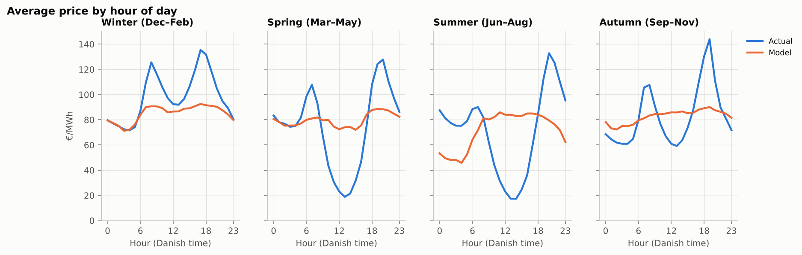

- Real prices have a strong daily shape. In spring and summer there is a deep
  midday dip, because solar pushes the price down to about 20 €/MWh. There
  are morning and evening peaks of 110–145 €/MWh, highest in winter and autumn.
- The model shows almost none of this. With imports fixed, solar mainly
  displaces imports in reality, while in the model it only shaves a little
  off a flat thermal price.

## 3. Why the model price is flat

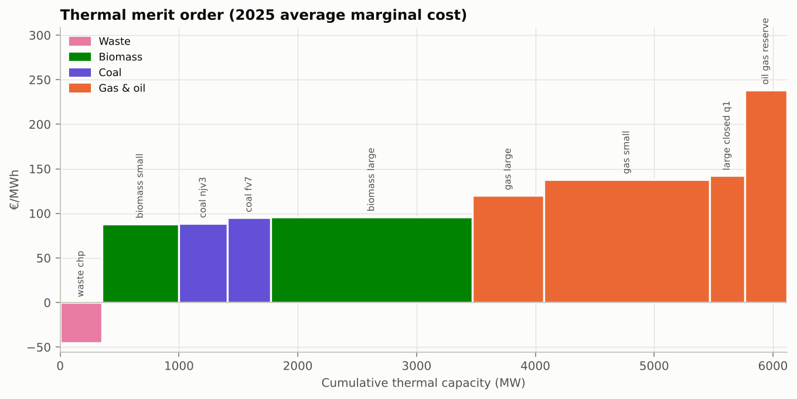

- In the model's merit order (cheapest plants first), the first ~3,500 MW is
  waste, small biomass, coal and large biomass, all between 85 and
  96 €/MWh. Gas only starts at about 120 €/MWh.
- After fixing net imports, Danish plants never need to supply more than about
  3.3 GW. **Gas is therefore never the price-setting plant.**

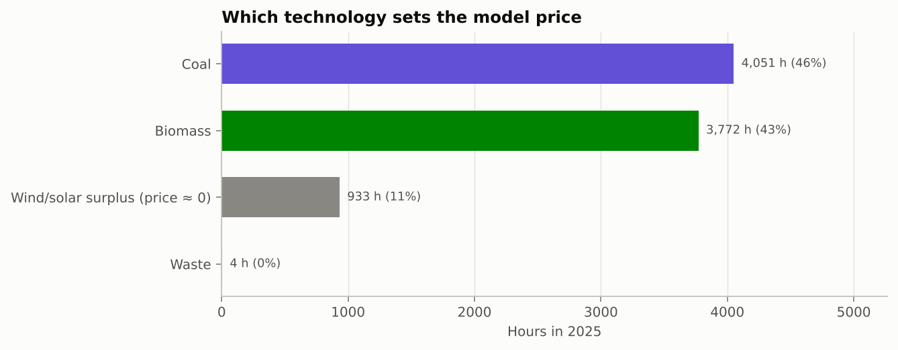

- Coal sets the model price 46% of the time, biomass 43%. In 11% of hours there
  is surplus wind/solar and the price is about zero.

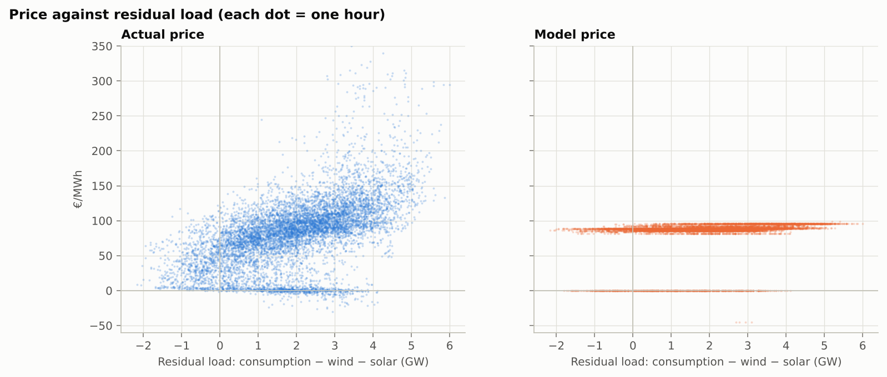

- **Actual:** the higher the residual load (consumption minus wind and solar),
  the higher the price, with spikes above 4 GW. Below zero residual load,
  prices fall towards zero.
- **Model:** two flat bands, about 90 €/MWh or zero, almost regardless of
  residual load.

## 4. The role of interconnectors

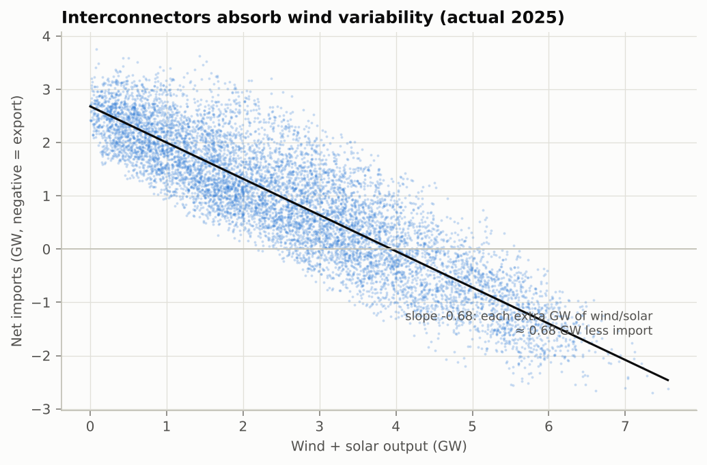

- Net imports and wind/solar output are strongly linked (correlation −0.89).
  On average, each extra GW of wind and solar means about 0.68 GW less import
  or more export.
- **The interconnectors are Denmark's main source of flexibility.** They are
  what links Danish prices to Germany, Norway and Sweden, and why an isolated
  model cannot reproduce hourly prices.

## 5. What wind and solar earn

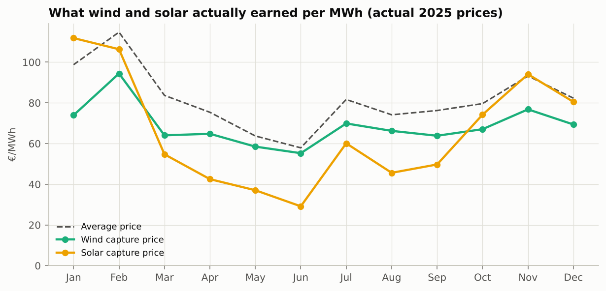

- Wind earned 69 €/MWh on average, 15% below the average price. Wind tends to
  blow at the same time across the region, which pushes prices down when it
  produces most.
- Solar is hit harder: 51 €/MWh, 38% below average, and around or under 40 €/MWh
  from April to June, when midday prices collapse.
- This gap (the "cannibalisation" effect) is what the wind-scaling scenarios
  will measure: it should grow as wind capacity grows.

## Conclusions

1. The baseline gets energy volumes right. Thermal output matches actual
   within 0.4%, and the annual average price is within 2 €/MWh.
2. It does not capture hourly price dynamics (correlation 0.33), because
   Danish prices are set by the coupled European market, not by Danish plants
   alone.
3. Scaling up wind with the current setup will mainly show more zero-price
   hours and more wasted wind (curtailment). Adding interconnectors (step 3)
   is needed to see how much of that surplus can be exported, and at what
   price.
